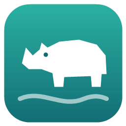

# Breathwork with Rhino 1.1

A calm breathing companion with a little rhino. Pick one of 11 breathing exercises and follow the circle: it grows when you breathe in, rests while you hold and shrinks when you breathe out. Every phase has its own colour, so you can follow along with your eyes half closed.

**Open it:** https://rpg86x.github.io/breathwork-with-rhino/

It is one HTML file without dependencies. It works offline in any modern browser: open `index.html` or use the link above. On a phone, choose *Add to Home screen*.

## Exercises

| # | Exercise | Rhythm (seconds) |
|---|----------|------------------|
| 1 | Longer exhale | in 4 · out 6 |
| 2 | Box breathing | in 4 · hold 4 · out 4 · hold 4 |
| 3 | Coherent breathing | in 5.5 · out 5.5 |
| 4 | Triangle | in 4 · hold 4 · out 4 |
| 5 | Physiological sigh | in 2 · a little more in 1 · long out 6 |
| 6 | 4-7-8 relaxation | in 4 · hold 7 · out 8 |
| 7 | Ujjayi · ocean breath | in 5 · out 7 |
| 8 | Nadi Shodhana (alternate nostril) | in L 4 · hold 4 · out R 4 · in R 4 · hold 4 · out L 4 |
| 9 | Slowly to sleep | in 4 · out 8 · rest 2 |
| 10 | Advanced box | in 6 · hold 6 · out 6 · hold 6 |
| 11 | Energise | in 4 · out 2 |

## Colour themes

Each theme gives the four breathing phases their own colour: breathe in, hold after inhale, breathe out and hold after exhale.

| Theme | In | Hold in | Out | Hold out |
|-------|----|---------|-----|----------|
| Classic | each exercise's own colours | | | |
| Solar Fire | `#EE8C42` | `#F2BD61` | `#C96860` | `#914C62` |
| Ocean Breath | `#38B8CA` | `#84D6D4` | `#387FA8` | `#304C83` |
| Forest Zen | `#78B78A` | `#B5C58B` | `#488F82` | `#506A65` |
| Cosmic Breath | `#A68BFA` | `#D3A5E8` | `#7D83CE` | `#534C94` |

## Controls

| Key | Action |
|-----|--------|
| `←` `→` / `<` `>` | Previous / next exercise (or swipe) |
| `1`–`9`, `0` | Jump to exercise 1–10 · `Home` / `End` first / last |
| `Space` | Pause / resume (start again when finished) |
| `R` | Start over |
| `+` / `−` | More / fewer rounds (∞ = endless, like a screensaver) |
| `T` | Next colour theme |
| `F` or double-click | Full screen |
| `L` | Dutch / English |

Your theme, language, rounds and last exercise are remembered in your browser. The controls fade out when you don't touch anything, so the app also works as a screensaver. It respects *reduce motion* in your system settings.

## Take care

Breathe comfortably and never force a hold. If you feel light-headed, stop and breathe normally. Sitting or lying down is best for the longer holds.

## Support

If this helps you relax, you can [buy me a coffee ☕](https://urbantechmonk.gumroad.com/coffee).

---

**Nederlands:** Een rustige ademhalingsapp met een neushoorn. Kies een van de 11 oefeningen en volg de cirkel: groeien bij inademen, stil bij vasthouden, krimpen bij uitademen. Werkt offline in elke browser, in het Nederlands en Engels. [Trakteer me op een koffie ☕](https://urbantechmonk.gumroad.com/coffee)

## License

MIT, see [LICENSE](LICENSE).
