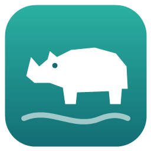

# Breathwork with Rhino 1.2

**Open the app · Open de app:** https://rpg86x.github.io/breathwork-with-rhino/

[English](#english) · [Nederlands](#nederlands)

---

## English

A calm breathing companion with a little rhino. Pick one of 11 breathing exercises and follow the circle: it grows when you breathe in, rests while you hold and shrinks when you breathe out. Every phase has its own colour.

### Install it as an app

- **Android (Chrome, Edge, Samsung Internet):** open the link and tap **Install app** in the top bar, or use the browser menu → *Install app* / *Add to Home screen*.
- **iPhone / iPad (Safari):** tap *Share* → *Add to Home Screen*.
- **Windows / Mac (Edge, Chrome):** click **Install app** in the top bar, or the install icon in the address bar.

Once installed it opens in its own window and works fully offline. When you're online it updates itself. The screen stays on while an exercise is running and may switch off again when you pause or finish.

You can also download `index.html` and open it directly. Everything works except installing and keeping the screen on.

### Exercises

| # | Exercise | Rhythm (seconds) |
|---|----------|------------------|
| 1 | Longer exhale | in 4 · out 6 |
| 2 | Box breathing | in 4 · hold 4 · out 4 · hold 4 |
| 3 | Coherent breathing | in 5.5 · out 5.5 |
| 4 | Triangle | in 4 · hold 4 · out 4 |
| 5 | Physiological sigh | in 2 · a little more in 1 · long out 6 |
| 6 | 4-7-8 relaxation | in 4 · hold 7 · out 8 |
| 7 | Ujjayi · ocean breath | in 5 · out 7 |
| 8 | Nadi Shodhana (alternate nostril) | in L 4 · hold 4 · out R 4 · in R 4 · hold 4 · out L 4 |
| 9 | Slowly to sleep | in 4 · out 8 · rest 2 |
| 10 | Advanced box | in 6 · hold 6 · out 6 · hold 6 |
| 11 | Energise | in 4 · out 2 |

### Colour themes

| Theme | In | Hold in | Out | Hold out |
|-------|----|---------|-----|----------|
| Classic | each exercise's own colours | | | |
| Solar Fire | `#EE8C42` | `#F2BD61` | `#C96860` | `#914C62` |
| Ocean Breath | `#38B8CA` | `#84D6D4` | `#387FA8` | `#304C83` |
| Forest Zen | `#78B78A` | `#B5C58B` | `#488F82` | `#506A65` |
| Cosmic Breath | `#A68BFA` | `#D3A5E8` | `#7D83CE` | `#534C94` |

### Controls

| Key | Action |
|-----|--------|
| `←` `→` / `<` `>` | Previous / next exercise (or swipe) |
| `1`–`9`, `0` | Jump to exercise 1–10 · `Home` / `End` first / last |
| `Space` | Pause / resume (start again when finished) |
| `R` | Start over |
| `+` / `−` | More / fewer rounds (∞ = endless, like a screensaver) |
| `T` | Next colour theme |
| `F` or double-click | Full screen |
| `L` | Dutch / English |

On your first visit the app follows your browser's language. After that it remembers your choice, theme, rounds and last exercise. The controls fade out when you don't touch anything, so it also works as a screensaver. It respects *reduce motion*.

### Take care

Breathe comfortably and never force a hold. If you feel light-headed, stop and breathe normally.

### Support

If this helps you relax, you can [☕ buy me a coffee](https://urbantechmonk.gumroad.com/coffee).

---

## Nederlands

Een rustige ademhalingsapp met een neushoorn. Kies een van de 11 oefeningen en volg de cirkel: hij groeit als je inademt, staat stil als je vasthoudt en krimpt als je uitademt. Elke fase heeft een eigen kleur.

### Installeren als app

- **Android (Chrome, Edge, Samsung Internet):** open de link en tik bovenin op **Installeer app**, of kies in het browsermenu *App installeren* / *Toevoegen aan startscherm*.
- **iPhone / iPad (Safari):** tik op *Deel* → *Zet op beginscherm*.
- **Windows / Mac (Edge, Chrome):** klik bovenin op **Installeer app**, of op het installatie-icoon in de adresbalk.

Eenmaal geïnstalleerd opent hij in een eigen venster en werkt hij volledig offline. Als je online bent werkt hij zichzelf bij. Het scherm blijft aan zolang een oefening loopt, en mag weer uit als je pauzeert of klaar bent.

Je kunt `index.html` ook downloaden en direct openen. Alles werkt dan, behalve installeren en het scherm aan houden.

### Bediening

Pijltjes of vegen om te wisselen, `spatie` voor pauze, `R` om opnieuw te beginnen, `+`/`−` voor het aantal rondes (∞ = eindeloos, als screensaver), `T` voor een ander kleurthema, `F` of dubbelklikken voor volledig scherm en `L` voor de taal. De oefeningen en kleurthema's staan in de tabellen hierboven.

Bij je eerste bezoek volgt de app de taal van je browser. Daarna onthoudt hij je keuze, thema, rondes en laatste oefening.

### Let op jezelf

Adem rustig en forceer nooit het vasthouden. Word je licht in je hoofd, stop dan en adem gewoon door.

### Steun

Helpt dit je ontspannen? [☕ Trakteer me op een koffie](https://urbantechmonk.gumroad.com/coffee).

---

## License · Licentie

MIT, see · zie [LICENSE](LICENSE).
